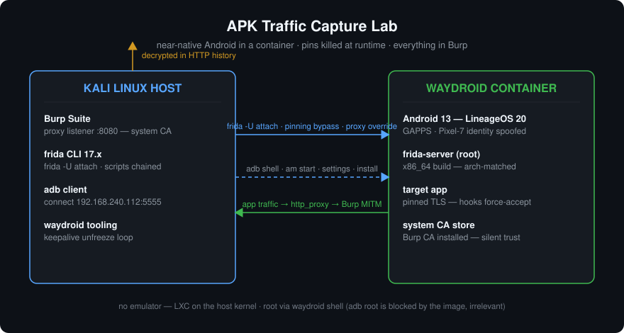

# Droidscope — Android MITM Lab


> **Near-native Android in a container on Linux. Any app installed, certificate pinning killed at runtime with Frida, every request decrypted in Burp.**



No emulator. Waydroid runs Android 13 in an LXC container on the host kernel — apps run at near-native speed, root is available out of the box, and the whole mobile-pentest loop (**install → unpin → intercept → capture**) runs in seconds. Built and battle-tested on Kali Rolling; every gotcha found during the build is baked into the scripts and documented below.

## What you get

| Piece | Detail |
|---|---|
| Android | LineageOS 20 (Android 13), GAPPS or vanilla image, SELinux disabled in the image |
| Device identity | Spoofed as a real device (Pixel 7 Pro / release-keys) — beats build.prop checks that make apps self-exit on generic devices |
| Root | `waydroid shell` attaches as root via LXC — `adb root` is blocked by the image, irrelevant |
| Frida | frida-server running as root, arch-matched to the host, version-matched to your `frida` CLI |
| Burp | Container traffic → your listener; Burp CA installed in the Android **system** store so normal apps trust it silently |
| Scripts | httptoolkit unpinning suite + late-load CWAC hooker + keepalive service |
| Burp MCP | If you run Burp with the MCP server, the whole proxy is scriptable: read history, fire Repeater, toggle intercept |

## Quickstart (fresh Kali)

```bash
git clone https://github.com/nexus956/droidscope && cd droidscope

./setup/01-install-waydroid.sh     # repo + packages + binder boot config
#   → if it says REBOOT REQUIRED: reboot, continue after login
./setup/02-init.sh                 # pull the Android image (~1.4 GB, GAPPS default)
./setup/03-session.sh              # boot Android — window appears on your desktop
./bin/frida-server-get.sh          # fetch frida-server matching host frida + arch
./bin/frida-server-run.sh          # push + start as root, verify with frida-ps -U
```

Then configure your interception target once:

1. **Burp listener** — `Proxy settings → Proxy listeners → Edit` → bind to **All interfaces** (or your LAN IP), any free port.
2. **Export Burp's CA** — `Proxy settings → Import / export CA certificate → Certificate in DER format`, save as `burp-ca.der`.
3. **Install the CA as a system cert** (one-time, survives reboots):
   ```bash
   ./bin/burp-cert-install.sh burp-ca.der
   ```
4. **Point `frida-scripts/config.js`** at your listener (`PROXY_HOST`, `PROXY_PORT`) — the proxy-override script forces apps through it. `CERT_PEM` should already hold your CA if you used the install script's output flow; if not, paste the PEM there with **no trailing newline** (the parser is strict).

## Daily workflow

**Burp-only mode** — captures HTTP + HTTPS for any app that doesn't pin:

```bash
./bin/rearm.sh burp-on 192.168.100.13:8081   # your listener address
# ...use the app, read Proxy → HTTP history...
./bin/rearm.sh burp-off                       # before closing Burp — always
```

**Full pinning bypass** — for pinned apps (banking, VPN apps, anything with hard pins). Attach the chain to the running app:

```bash
PID=$(adb -s 192.168.240.112:5555 shell pidof <package>)
frida -U -p $PID \
  -l frida-scripts/config.js \
  -l frida-scripts/android-certificate-unpinning.js \
  -l frida-scripts/android-proxy-override.js
```

Now the app's pinned requests flow through Burp and decrypt. For the login flows that matter, attach **before** you type credentials.

**Flutter targets**: use `android-disable-flutter-certificate-pinning.js` — regular unpinning misses Flutter's bundled BoringSSL.

**Hostile targets**: add `android-disable-root-detection.js` to the chain if the app checks for root.

## What Burp alone sees vs. what needs Frida

| Target traffic | Burp only | With frida chain |
|---|---|---|
| Plain HTTP | ✅ | ✅ |
| HTTPS, no pinning (most apps, browsing) | ✅ — system CA installed | ✅ |
| HTTPS, pinned (banking, VPN apps, Google/Play) | ❌ silent — pins reject Burp's cert inside the app | ✅ decrypted |
| Payload-level encryption, proxy-evading stacks | ❌ invisible to any proxy | ✅ hook the encrypt call, read plaintext |
| Apps that self-exit on container detection | ❌ | ✅ + device-identity spoof (already in the image) |

## Kali gotchas — found the hard way, all handled by the scripts

- **binder loads with one device.** Kali's kernel ships `CONFIG_ANDROID_BINDER_DEVICES="binder"` and no binderfs. Waydroid needs `binder,hwbinder,vndbinder` — fixed at module load via `/etc/modprobe.d/` (written by `01`).
- **The binder module is `[permanent]`.** Kali pins `binder_linux` — `rmmod` fails even with zero holders, so a running system can't be fixed in place. Reboot; the config takes effect at boot. That's why the installer says REBOOT REQUIRED instead of reloading.
- **`waydroid shell` chokes on flags.** Its argparse rejects anything option-like (`sh -c`, `mount -o`). Workaround used throughout: drop the command into a script under `/data/local/tmp/` via adb, execute by path.
- **`waydroid init` needs root.** Every script self-elevates via `pkexec` (GNOME dialog) with a `sudo` fallback.
- **adb unauthorized on first connect** — accept the RSA dialog on the Android screen ("always allow"), or push `~/.android/adbkey.pub` into `/data/misc/adb/adb_keys/`.
- **frida-server arch:** the container is the host's arch — x86_64 host needs the `android-x86_64` build, **not** arm64. The #1 failure in the field. `frida-server-get.sh` handles it.
- **frida versions must match exactly.** Host CLI == server version or every command dies at handshake. `frida-server-get.sh` pins them.
- **frida spawn is broken inside waydroid** (`i/O error`, even on Settings). Attach by PID within ~3 s of app launch instead — catches everything that matters.
- **The container auto-freezes** when its window loses focus — everything inside silently stops (reads as "no network", "app broken", "capture dead"). The `waydroid-keepalive.service` (installed by the kit) thaws it every 30 s. Off switch: `systemctl --user stop waydroid-keepalive`.
- **Burp Proxy Intercept resets to ON** on every fresh Burp instance — held requests never reach history and it looks exactly like "capture not working". Check it first. With Burp's MCP server: `set_proxy_intercept_state(false)` from a script.
- **The container proxy outliving Burp black-holes Android.** If the proxy is set and Burp closes, the whole container looks offline. `rearm.sh burp-off` before closing Burp, always.

## Field notes from real captures

- **ProtonVPN (ch.protonvpn.android)** connects to raw IPs, not hostnames — its own DNS-resolve + connect-by-IP anti-censorship design. In Burp the Proton API traffic shows `Host: 3.71.90.93` style headers. It still decrypts: the CONNECT goes through the proxy and the frida hooks force acceptance. Auth flow (Bearer token, UID, session cookies) captures in clear with the chain attached; telemetry captures even without.
- **8 Ball Pool (com.miniclip.eightballpool)** runs ~15 s then self-exits in-container — AnyBrain anti-cheat + environment checks deeper than build props. The lane for that is APK surgery (strip/stub the anti-cheat lib, re-sign, reinstall), not scripts alone.
- Pinned apps that R8-obfuscate their pinning classes dodge name-based hooks — `net-enum-test.js` enumerates the loaded classes so you can hook the renamed pinner by its real name.

## Troubleshooting

| Symptom | Fix |
|---|---|
| `Binder node "vndbinder" not found` | binder loaded with wrong device set — reboot (config from `01` applies) |
| `modprobe: could not remove 'binder_linux'` | expected on Kali — module is `[permanent]`, reboot instead |
| `adb: device unauthorized` | accept the dialog on the Android screen, or push the adbkey into `adb_keys` |
| `adb root` → `not available in Waydroid` | by design — root comes via `waydroid shell`, scripts use it |
| frida `Failed to spawn: i/O error` | spawn is broken in waydroid — attach by PID instead |
| frida `No certificate was provided` / PEM format errors | `config.js` `CERT_PEM` — strict parser: PEM inside the backticks, no trailing newline |
| Nothing in Burp history, sockets connect fine | **Intercept is on** — toggle it off (first thing to check, every time) |
| Whole container looks offline | proxy set but Burp closed — `./bin/rearm.sh burp-off` |
| App starts, dies after ~15 s silently | container/environment detection — spoof is already in; next step is APK surgery |
| `waydroid status` → Container: FROZEN | keepalive not running — `systemctl --user start waydroid-keepalive` |

## Layout

```
setup/         01-install-waydroid.sh · 02-init.sh · 03-session.sh
bin/           rearm.sh · burp-cert-install.sh
               frida-server-get.sh · frida-server-run.sh
               waydroid-keepalive.service · frida-server (not in git)
frida-scripts/ config.js · unpinning + override + late-hook suite
               net-enum-test.js · trace-kill.js
docs/          architecture.svg
```

## Tested stack

Kali Rolling 2026.3 (kernel 7.2.15, GNOME Wayland) · waydroid 1.6.3 · LineageOS 20 GAPPS (Android 13) · frida 17.24.3 (CLI + server, x86_64) · Burp Suite 2026.10.1

## Credits & licenses

- [Waydroid](https://github.com/waydroid/waydroid) — Android in a container (GPL)
- [Frida](https://github.com/frida/frida) — dynamic instrumentation toolkit
- [httptoolkit/frida-interception-and-unpinning](https://github.com/httptoolkit/frida-interception-and-unpinning) — unpinning script suite (AGPL / © Tim Perry)
- [Burp Suite](https://portswigger.net/burp) — PortSwigger

MIT — do whatever. Test targets you're authorized to test.
